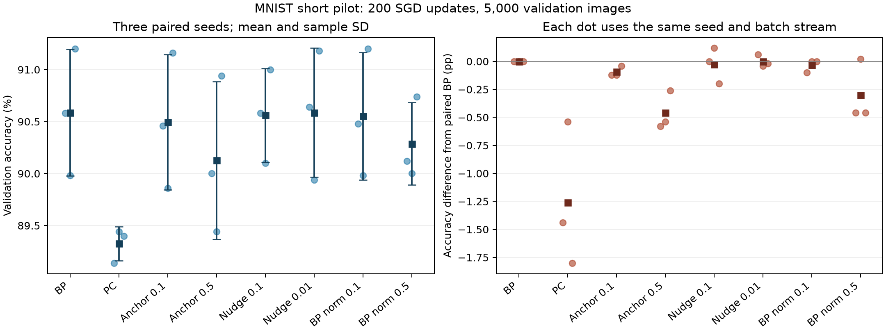

# MNIST anchored-PC short pilot — 2026-10-31

## Decision

**Completed local CPU pilot; no anchored-PC advantage at the tested settings.**
Both interior blends were below paired BP on validation accuracy and above BP on validation cross-entropy in all three seeds. This is a bounded negative result, not a proof that every anchored rule fails. PC inference passed the convergence checks on this small model, so solver failure does not explain this result.

## Question and matched controls

Does `g_beta = (1-beta) g_spike + beta g_PC` improve short-run supervised learning compared with BP, converged standard PC, weak-nudge PC, and a BP-direction control with the same update norm?

The spike anchor uses two scheduled unit hidden-state updates with frozen initial predictions and inputs. It calls no BP oracle. The blends use beta=0.1 and 0.5; standard PC uses lambda=1. Weak-nudge PC uses lambda=0.1 and 0.01 and divides the local gradient by lambda. Each BP norm control follows direct BP at its own current parameters, with the post-clipping norm of its corresponding blend computed at those same parameters. It therefore tests a scalar update-size explanation, rather than importing the norm from a different trajectory.

## Results

Values are means +/- sample standard deviations over three paired seeds. These are **validation** measurements, not official MNIST test scores. Each paired difference uses the same initialization and batch stream.

| Method | Validation accuracy (%) | Validation CE | Paired accuracy change from BP (pp), seeds 1/2/3 |
|---|---:|---:|---|
| BP | 90.587 +/- 0.610 | 0.327565 +/- 0.016027 | +0.00, +0.00, +0.00 |
| Standard PC | 89.327 +/- 0.163 | 0.357470 +/- 0.005128 | -1.44, -0.54, -1.80 |
| Anchored PC, beta=0.1 | 90.493 +/- 0.651 | 0.329937 +/- 0.017211 | -0.12, -0.12, -0.04 |
| Anchored PC, beta=0.5 | 90.127 +/- 0.758 | 0.339711 +/- 0.018640 | -0.58, -0.54, -0.26 |
| Weak-nudge PC, lambda=0.1 | 90.560 +/- 0.450 | 0.329072 +/- 0.014840 | +0.00, +0.12, -0.20 |
| Weak-nudge PC, lambda=0.01 | 90.587 +/- 0.622 | 0.327837 +/- 0.016506 | +0.06, -0.04, -0.02 |
| BP norm control, beta=0.1 | 90.553 +/- 0.613 | 0.329274 +/- 0.014360 | -0.10, +0.00, +0.00 |
| BP norm control, beta=0.5 | 90.287 +/- 0.397 | 0.335323 +/- 0.006287 | -0.46, +0.02, -0.46 |

The beta=0.1 anchor also lost to its BP norm control in all three seeds (accuracy differences -0.02, -0.12, -0.04 pp). The beta=0.5 differences versus its norm control were -0.12, -0.56, +0.20 pp. Weak-nudge lambda=0.01 approximately matched BP accuracy; it did not establish a gain. No significance claim is made from three seeds.



## Protocol and data

- Standalone JAX float64 MLP: 784 -> 128 -> 64 -> 10, tanh hidden activations, linear logits, softmax cross-entropy.
- Per-example PC energy: one half squared error summed over each hidden vector, plus lambda times output CE. Latent updates use the gradient of the sum across examples; parameter gradients average across examples. Thus batch size does not implicitly change the clamp strength.
- This is an independent small-MLP mechanism experiment. It does not change FabricPC's trainers and does not replicate the earlier BERT energy convention.
- Canonical MNIST compressed-file checksums were checked against [Torchvision's primary dataset definition](https://raw.githubusercontent.com/pytorch/vision/main/torchvision/datasets/mnist.py). All four files matched; SHA256 fingerprints are in `summary.json`.
- Split seed 20261031: 10,000 training-pool images and 5,000 disjoint validation images, drawn from the 60,000-image training split. The official test split was never parsed, scored, or used for tuning. Its compressed bytes were only checksum-verified.
- SGD, global gradient norm clip 2, no momentum, dropout, weight decay, or augmentation. Batch size 64, sampling with replacement. Each pilot run has 200 updates / 12,800 sampled examples, not 200 epochs or necessarily all unique training images.
- Equal tuning grid for every method: learning rates 0.03, 0.1, 0.3; seed 0; 50 updates per trial; choose lowest complete-trial validation CE. All eight methods selected 0.3, the upper grid boundary. This is grid-limited tuning, not proof of an optimal learning rate or high-rate robustness.
- Fresh paired training seeds 1, 2, 3. Every method within a seed shares initial parameters, data, and batch order; one parameter update occurs after forming the chosen gradient.
- All 24 tuning trials and all 24 paired pilot trials completed. No failed trial was silently dropped. The run took 226.01 seconds on local CPU, including compilation and calibration, inside a 30-minute budget.

## Numerical validity

- Maximum layerwise spike-vs-BP relative error on two calibration batches at initialization and after 20 BP updates: 4.15e-16. Independent derivative tests cover latent and local parameter gradients.
- Common selected solver: inference rate 0.2, T=240; the returned gradient uses 2T=480 latent steps. T and 2T share a trajectory.
- The solver passed all 12 calibration cases: two parameter states x two batches x three lambda values. Selection margins were residual ratio <=1e-4 and T/2T gradient change <=0.001, stricter than training gates.
- Every PC-family training update required finite gradients, residual ratio <=0.001 and relative T/2T gradient change <=0.01 before applying an update. Across the paired pilot, maximum values were 7.89e-9 and 5.58e-5 respectively. Residual ratio is final latent-gradient norm divided by its initial value. These checks establish the specified numerical criteria, not a proof of a global energy minimum.
- A separately labeled **post-run** geometry diagnostic on the four calibration state/batch pairs found PC/BP cosine 0.9371–0.9718. The perpendicular blend correction relative to BP norm was 1.26–2.32% for beta=0.1 and 6.32–11.60% for beta=0.5. The correction is nontrivial. This measurement was not a prospective pre-training gate; see `post_run_geometry.json`.
- Median recorded update duration: about 0.685 ms for BP and 40.5–40.9 ms for the PC-family methods. This reference implementation computes inference and diagnostics, and norm controls also compute the blend. These are diagnostic timings, not an optimized throughput benchmark or an equal-wall-time comparison.

## Verification and self-review

**Full repository suite: 566 passed, 1 expected failure, 1 warning in 318.77 seconds.** The warning is Optuna's experimental `group` option in the existing tuner test. Focused experiment tests: 20 passed (7 MNIST plus 13 prior anchored-PC tests). Standalone Colab-style import check: 7 passed. Black and mypy passed for the added module/tests as applicable; notebook JSON and all code-cell syntax were checked.

Verification commands (project virtual environment; CPU):

```sh
JAX_PLATFORMS=cpu python -m pytest -q -p no:cacheprovider
python -m pytest tests/test_anchored_mnist.py tests/test_anchored_pc.py -q -p no:cacheprovider
python -m black --check fabricpc/experiments/anchored_mnist.py tests/test_anchored_mnist.py
python -m mypy --follow-imports=silent --cache-dir=/tmp/anchored-mnist-mypy fabricpc/experiments/anchored_mnist.py
git diff --check
```

Standalone tests run from a temporary folder with only the import path changed. Check logs are saved in `pilot_20261031/`. ZIP source/test hashes and notebook code-cell syntax also passed verification. No separate build was run: this change adds a standalone Python experiment rather than changing package/build configuration.

Self-review covered gradient signs, lambda scaling, per-example normalization, frozen spike inputs, no latent-gradient flow into local updates, clipping order, matched-norm controls, shared initialization/batch streams, split overlap, checksum provenance, budget/failure reporting, and source hash consistency. Training source SHA256 matches the saved historical source and local archival Colab bundle. The current branch source and notebook also contain the later GPU-runner additions; they are not byte-identical to that historical snapshot. No production trainer changed.

The first root-level pytest attempt encountered duplicate test discovery from an extracted copy of the Colab kit. The extracted copy was removed, the ZIP retained, and the evidence copy was renamed `.py.txt`; the full check was then restarted. This packaging issue did not affect the experiment run.

## Scope and next decision

This establishes that the anchor is numerically BP-equivalent and that standard PC can converge in the specified MNIST MLP, yet neither tested blend improves the short-run validation result. It does not establish better accuracy, forgetting resistance, depth scaling, transformer performance, novelty, or a general speed advantage. The same validation split served tuning and pilot measurement; an official held-out test should be used only after a new protocol is fixed.

Do not expand training merely to seek a positive number. If the research question is specifically high-learning-rate stability, the next bounded experiment should freeze a wider common rate grid and evaluate failure rates and paired accuracy under that separate hypothesis. The present result gives no reason to claim anchored-PC superiority.

## Reproduce and inspect

- Raw run, configuration, calibration, seeds, source hash, metrics: [summary.json](pilot_20261031/summary.json).
- [Aggregate statistics](pilot_20261031/aggregate.json), [trial table](pilot_20261031/trials.csv), [live run log](pilot_20261031/run.log), [package environment](pilot_20261031/environment.txt).
- Saved split and batch indices, calibration traces, and all 24 final parameter sets are alongside those files.
- Local archival Colab ZIP kit (`anchored_mnist_colab_kit.zip`, not published in Git) includes the pinned source, tests, and notebook. Extract it, open `anchored_mnist.ipynb` in Colab, and upload the two Python files when prompted. The notebook verifies their hashes, downloads public MNIST files, runs the same checks and protocol on CPU, and exports the results.
- **Colab execution remains unverified.** The experiment reported here ran locally because browser automation remained blocked by the workspace spend cap. The notebook's cells were syntax-checked and its standalone source/tests ran locally; this is not a live Colab run.

Local experiment command:

```sh
JAX_PLATFORMS=cpu python -m fabricpc.experiments.anchored_mnist \
  --data-dir /path/to/MNIST/raw \
  --output-dir results/anchored_mnist/new_run \
  --steps 200 --tune-steps 50 --budget-seconds 1800
```

Output directories must be new. At the time of the local pilot, no commit, staging, push, or PR had been made. The source snapshot used for those numbers is retained in `pilot_20261031/anchored_mnist.py`; its SHA256 remains the one in `summary.json`. The later GPU runner adds a separate protocol without changing the original pilot defaults.


## GPU follow-up runner — prepared 2026-11-01

The current CLI and `examples/anchored_mnist.ipynb` support the separately planned fixed-rate sweep. **No GPU sweep result is claimed.** A one-update CPU smoke run exercises all 54 trial cells but is only an integration check.

Use Linux with an NVIDIA GPU, Python 3.12 or newer, and a CUDA-12-compatible driver (JAX documents Linux driver >=525). The supplied requirements use CUDA 12 pip wheels to match the earlier Colab stack. See the [official JAX installation instructions](https://docs.jax.dev/en/latest/installation.html). Start with a fresh virtual environment so CUDA 13 plugins from another environment cannot interfere.

```sh
git clone --branch feat/anchored-pc-diagnostic --single-branch https://github.com/scodesy/ContinualPC-Transformers.git
cd ContinualPC-Transformers
python3.12 -m venv .venv
source .venv/bin/activate
python -m pip install -r examples/anchored_mnist_gpu_requirements.txt
JAX_PLATFORMS=cuda python -u fabricpc/experiments/anchored_mnist.py \
  --protocol rate-sweep --require-gpu --download \
  --data-dir data/MNIST/raw --output-dir outputs/anchored_mnist_rate_sweep \
  --steps 200 --budget-seconds 1800
```

The standalone script needs only JAX and NumPy; it does not require installing all FabricPC dependencies. `--download` retrieves the public MNIST files with checksum checks and atomic publication, preserving cached valid files. A bad existing checksum stops the run. Use a fresh output directory for every invocation.

The fixed sweep has six methods x three rates (0.3, 1.0, 3.0) x three paired seeds (1, 2, 3), 200 updates each. It reuses the pilot's data split, initialization, batch-stream seeds, energy, clipping, and numerical gates. It has no learning-rate tuning and preserves failed trial rows. `inference_failed`, `nonfinite_inference`, `nonfinite_gradient`, and `nonfinite_validation` are separate statuses. Finite poor accuracy is not relabeled as divergence. No official test images are scored.

Inspect `summary.json`: `status=complete` means every planned trial was attempted; `all_methods_completed` separately reports whether every trial finished its updates. Compare accuracy/loss and failure counts at each rate, with seedwise BP and norm-control comparisons. Do not average only successful runs and call that superiority. A budget exhaustion, anchor failure, or failed solver selection exits nonzero and preserves incremental evidence. The runner saves the source snapshot/hash, backend, device kind, package versions, split/batch indices, calibration traces, and final parameters. GPU arithmetic can change the calibration outcome; passing CPU calibration does not guarantee GPU calibration.

Decision criterion: pursue a larger study only if an anchored blend consistently improves the stability/accuracy tradeoff against both BP and its matching norm control. If the bounded sweep shows no such benefit, stop this rule rather than extending training to seek a positive result. Three seeds remain a screen, not a confirmatory claim.

The clone includes small reports, summaries, plots, and historical source snapshots. Large training states, dataset caches, local archives, and detailed runtime logs remain local. The BERT-Mini diagnostic additionally needs its original checkpoint/news bundle; the MNIST runner downloads its own public data.


GPU-runner verification on 2026-11-01: full repository suite **571 passed, 1 expected failure, 1 existing Optuna warning in 250.91 seconds**; targeted anchored-PC/MNIST suite **25 passed**; standalone notebook-style tests **12 passed**. Black passed for five source/test files; mypy passed for both experiment modules and the BERT packaging helper. All notebook code cells parsed and saved outputs were empty; the GPU notebook's source/test hashes matched the current files. The one-update CPU sweep smoke completed all 54 unique cells and saved 54 distinct parameter files in 10.51 seconds. This was only runner verification, not a higher-rate scientific result. Live GPU execution and GPU installation remain unverified.
