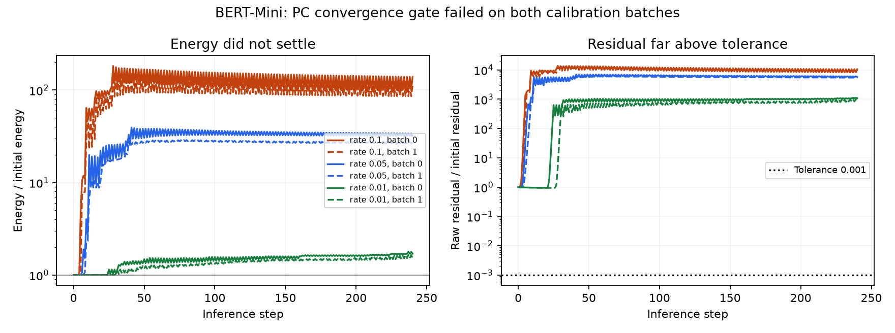

# Anchored PC Stage A: Colab result

Date: 2026-10-24. Decision: **no-go for training under this configuration**.

We ran the fixed-weight diagnostic on the existing BERT-Mini checkpoint and checksum-verified news cache in a Google Colab T4 runtime. The scientific diagnostic took **430.09 seconds** including its JAX compilation. Runtime setup, verification tests and evidence transfer are outside that number.

## What passed

- Four tiny float64 anchor checks passed: dropout off/on, original/perturbed weights.
- All 16 real-checkpoint float32 anchor checks passed: eight training batches with dropout off, then the same eight with shared dropout masks at rate 0.1.
- Across checkpoint modules, the largest relative anchor gradient error was **0.00087205** (limit 0.001), and the smallest defined cosine was **0.9999996306** (limit 0.9999).
- The local repository suite reported **559 passed, 1 expected failure, 1 warning**. Final focused local checks reported **13 passed**. The Colab checks reported **13 passed, 1 warning**. Formatting and targeted type checks passed.
- A clean CUDA smoke computation passed after removal of Colab's incompatible preinstalled CUDA 13 plugin. The diagnostic used the pinned CUDA 12 JAX stack.

## What stopped the experiment

None of the nine PC solver settings passed on both calibration batches. Rates were 0.1, 0.05 and 0.01. Each T/2T comparison stayed within the preregistered 240-step cap. All traces stayed finite, but they failed the convergence criteria.

The forcing-relative raw residual had to be at most 0.001, and the relative change in parameter gradients between T and 2T had to be at most 1%. The results were far from those thresholds:

| Latent rate | T/2T | Residual / initial residual, two batches | Parameter-gradient change, two batches | Passed |
| --- | --- | --- | --- | --- |
| 0.1 | 30/60 | 12436.53–13100.34 | 42.30%–60.06% | 0/2 |
| 0.05 | 30/60 | 5877.36–5996.32 | 32.28%–40.91% | 0/2 |
| 0.01 | 30/60 | 525.02–1029.20 | 61.73%–82.33% | 0/2 |
| 0.1 | 60/120 | 11180.37–11784.49 | 25.56%–82.38% | 0/2 |
| 0.05 | 60/120 | 5690.06–5952.25 | 24.81%–25.36% | 0/2 |
| 0.01 | 60/120 | 687.56–1012.28 | 34.73%–52.87% | 0/2 |
| 0.1 | 120/240 | 10041.39–10501.48 | 35.56%–56.37% | 0/2 |
| 0.05 | 120/240 | 5438.10–5729.34 | 17.18%–21.98% | 0/2 |
| 0.01 | 120/240 | 838.29–1078.30 | 17.93%–22.17% | 0/2 |

Even at 240 steps, gradients changed by 17.18%–56.37% when compared with 120 steps across the tested rates and batches. The residual grew rather than reaching the initial forcing-relative tolerance. These are unconverged finite-inference gradients; we cannot label them equilibrium gradients.



## Interpretation and next decision

The spike-only BP anchor is usable at the stated tolerance for these batches. The tested standard-PC relaxation is not ready for an equilibrium-gradient comparison. We therefore stopped before PC-Nudge comparisons, beta and learning-rate probes, norm-matched one-step loss comparisons, and training. No claim about anchored PC's benefit, novelty, or failure follows from this run.

The next bounded diagnostic should test smaller latent rates and inspect energy/residual growth on the same two calibration batches before repeating the gate. That is a new solver configuration and was not silently added to this run. A longer training sweep is premature.

## Reproduction and evidence

- Source base: `68088cb22fe80e258d760ea5690aa1e9603383f4`; uncommitted implementation on `feat/anchored-pc-diagnostic`.
- Colab: https://colab.research.google.com/drive/1u1ovIO7eee-y6ZIfJLGOxx62joPCEcbZ
- Uploaded bundle SHA-256: `85923dab55dce8de03c5b4abc5d96275f88756f7033b24fb1bce774f0a0ffd65`.
- Downloaded evidence ZIP SHA-256: `66ecf68b653626be5ba02924ad3d4c764e5b6d5758d96555373c7f84bc6280e6`.
- Raw evidence: `run/summary.json`, `run/events.jsonl`, `run/probe_batches.npz`, all 18 calibration traces, `run/environment.txt`, `run/hardware.txt`, `run/colab_tests.log`, `run/process.log`, and `run/bundle_manifest.json`.
- The manifest records hashes of the actual uncommitted diagnostic source and all input files. The source bundle intentionally has no Git metadata; the harmless Git lookup message in the process log is handled by the runner.
- Colab bootstrap fixes are retained in the notebook: editable installation for package metadata, an empty tests-package marker to prevent name shadowing, and removal of the incompatible preinstalled CUDA 13 plugin. No model source or frozen data was changed in Colab.

Local verification commands:

```text
python -m pytest -q -p no:cacheprovider
python -m pytest tests/test_anchored_pc.py tests/test_domain_forgetting_standard_pc.py -q -p no:cacheprovider
python -m pytest tests/test_anchored_pc.py -q -p no:cacheprovider
python -m black --check fabricpc/experiments/anchored_pc.py examples/pack_anchored_pc_colab.py tests/test_anchored_pc.py
python -m mypy --follow-imports=silent --cache-dir=/tmp/anchored-mypy-cache examples/pack_anchored_pc_colab.py fabricpc/experiments/anchored_pc.py
```

The full suite used the project environment in the separate worktree. The type checker initially hit an internal cache error; the fresh-cache run passed. The full suite's warning was Optuna's existing experimental grouped sampler warning; the expected failure covers the older non-exact spike graph. Colab's warning concerned the preinstalled plugin, removed before the GPU experiment.

Scope limit: one checkpoint, one domain, one seed, two calibration batches. The other six training batches were used for anchor checks only. Held-out validation batches were materialized and saved but were not scored because the convergence gate stopped the run. We implemented later Stage A comparisons, but did not execute those paths in this scientific run.


## Publication note — 2026-11-01

This report records the original uncommitted run state. The branch now includes the diagnostic source, notebooks, tests, and small evidence summaries for publication. Large checkpoint/data bundles and detailed calibration archives remain local. The MNIST GPU follow-up has its own instructions in `results/anchored_mnist/report.md`; it needs no BERT checkpoint or news cache.
